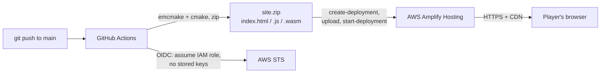

# Breakout

A small, polished Breakout game in modern C++17 and raylib, compiled to WebAssembly and
hosted on AWS Amplify Hosting, with every push to `main` deployed by GitHub Actions.

**[▶ Play now](https://main.d1h0spgv1b4kq3.amplifyapp.com)**

<!-- Gameplay GIF goes here: docs/gameplay.gif -->

## Controls

| Key | Action |
|---|---|
| ← → | Move the paddle |
| Space | Start · launch the ball · next level |
| P | Pause / resume (the game also pauses when the tab loses focus) |
| R | Restart after game over or a win |

Three levels, three lives. Bricks take 1–3 hits; the ball gets 8% faster each level.
The best score is saved (in `localStorage` in the browser, in `highscore.txt` on desktop).

## Building

The same source builds for desktop and the web. raylib 5.5 is fetched by CMake, so there is
nothing to install besides a compiler, CMake and (for the web) Emscripten.

**Desktop (Linux / WSL)**

```bash
sudo apt install build-essential cmake libx11-dev libxrandr-dev libxinerama-dev \
                 libxcursor-dev libxi-dev libgl1-mesa-dev
cmake -B build && cmake --build build
./build/breakout
```

**Web**

```bash
source ~/emsdk/emsdk_env.sh
emcmake cmake -B build-web -DCMAKE_BUILD_TYPE=Release && cmake --build build-web
cd build-web && emrun index.html
```

Both builds compile with `-Wall -Wextra` and no warnings.

## Architecture

```
src/
├── main.cpp          window, main loop (desktop + Emscripten), focus handling
├── Game.h/.cpp       state machine; owns every game object
├── Entity.h          tiny base class: update(dt), draw()
├── Paddle.h/.cpp     ┐ derive from Entity
├── Ball.h/.cpp       ┘
├── Brick.h           plain struct + colour lookup
├── Level.h/.cpp      level layouts as strings, loader
├── Collision.h       circle-vs-rectangle helpers (header-only)
├── Particles.h/.cpp  fixed-size particle pool
├── Storage.h/.cpp    high score: localStorage on web, file on desktop
└── Constants.h       every tunable number and colour
```

### Fixed timestep

Physics always advances in steps of exactly 1/120 s. Each frame adds the real elapsed time
to an accumulator and runs as many whole steps as fit, carrying the remainder over. The game
plays the same at 30 FPS or 144 FPS, and the physics is deterministic. Frame time is
clamped to 0.25 s, so a stall can't trigger hundreds of catch-up steps.

Key presses are handled once per rendered frame rather than inside the physics step. A frame
can run zero or two steps, so handling presses in the step could miss a press or apply it
twice. Only the held paddle direction is read by the steps.

### State machine

`enum class GameState { Menu, Playing, Paused, LevelClear, GameOver, Win }`, with a `switch`
in `update`, `draw` and input handling. Every state's behaviour is in one place, and the
compiler warns if a new state is not handled.

### Collision

- **Ball vs. rectangle** uses the closest point on the rectangle to the ball's centre: they
  overlap if that point is within one radius.
- **One brick per step.** If the ball touches several bricks (say, in the gap between two),
  only the closest one is resolved. A corner hit can't break two bricks or bounce twice.
- **Which side was hit.** A ball can only have come in through a face it is moving toward
  (moving up-right means the bottom or left face). Of those two, the one with less overlap
  is the entry face. The ball is pushed out through it and that velocity component is
  reflected. Bricks the ball is already moving away from are ignored.
- **No tunnelling.** `static_assert(BALL_MAX_SPEED * FIXED_DT < BALL_RADIUS)`: at top speed the
  ball moves 5.4 px per step, less than its 8 px radius, so it can't pass through an edge
  without overlapping first. Raising the speed past that limit stops the build.
- **Paddle angle.** The hit position along the paddle (−1 … +1) maps linearly to a bounce
  angle of up to 60° from vertical, so players can aim.
- **Anti-stuck.** Every bounce goes through `Ball::setDirection`, which keeps the vertical
  speed at least 25% of the total. The ball can't crawl sideways forever.

### Bricks as a `std::vector<Brick>` of plain structs

A brick is just a rectangle, HP, max HP and a flash timer, stored by value. The vector is one
contiguous allocation per level, so it is cache-friendly to scan every step and trivial to
copy or reset. Broken bricks stay in the vector with `hp == 0` rather than being erased:
nothing shifts mid-level, and the "level cleared" check is a single `none_of`. Polymorphism
would add nothing here, since all bricks behave the same.

### Particle pool

Particles live in a `std::array<Particle, 256>` that is reused as a ring buffer. Spawning is
O(1) with no allocations during play. If the pool ever fills, the oldest particle is
overwritten, which isn't noticeable at this size.

### Ownership

`Game` owns the paddle, ball, bricks and particles by value. There is no `new`/`delete` and
no smart pointers, because nothing needs shared or dynamic lifetime. `Entity` has protected
copy and move operations, so a derived object can't be sliced through the base.

### Web specifics

- The browser drives the loop with `emscripten_set_main_loop(frame, 0, 1)` (no ASYNCIFY).
  That call never returns, so the game state lives at file scope rather than on `main`'s
  stack.
- On the web, raylib's `IsWindowFocused()` never changes, because Emscripten's GLFW drops
  focus events, and a hidden tab runs no frames to poll from. Instead, `blur` and
  `visibilitychange` callbacks set a flag that pauses the game before the next physics
  step. Coming back to the tab never moves the ball.
- The high score goes to `localStorage` through `EM_ASM`, wrapped in `try`/`catch` so that
  browsers with storage disabled still run the game.

## Deployment



- GitHub Actions authenticates with OIDC and gets short-lived credentials. The IAM role
  trusts only this repository's `main` branch.
- That role can only create, start and check deployments on this one Amplify app. It can't
  change the app, read other resources or touch anything else in the account.
- Each deploy zips the three build files, uploads them to a pre-signed URL from
  `amplify create-deployment`, starts the deployment and polls the job until it succeeds or
  fails, so a bad deploy fails the workflow.
- Amplify Hosting serves the files over HTTPS from its CDN. There's no bucket or distribution
  to manage, and no cache to invalidate.
- No AWS account IDs, role ARNs or keys are in the repository. The app ID and region are
  GitHub repository variables, and the role ARN is a secret.

Setup steps: [docs/aws-setup.md](docs/aws-setup.md).

## Possible future work

- **Power-ups**: multi-ball, wider paddle, slow ball. They would drop from bricks as
  another fixed pool.
- **Online leaderboard**: API Gateway + Lambda + DynamoDB, with the client posting scores
  over HTTPS.
- **Touch controls**: drag to move and tap to launch, for phones and tablets.
